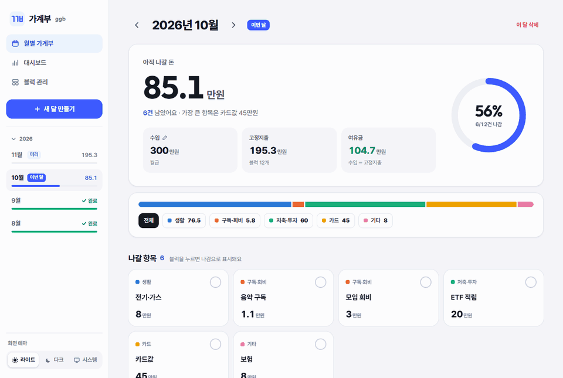
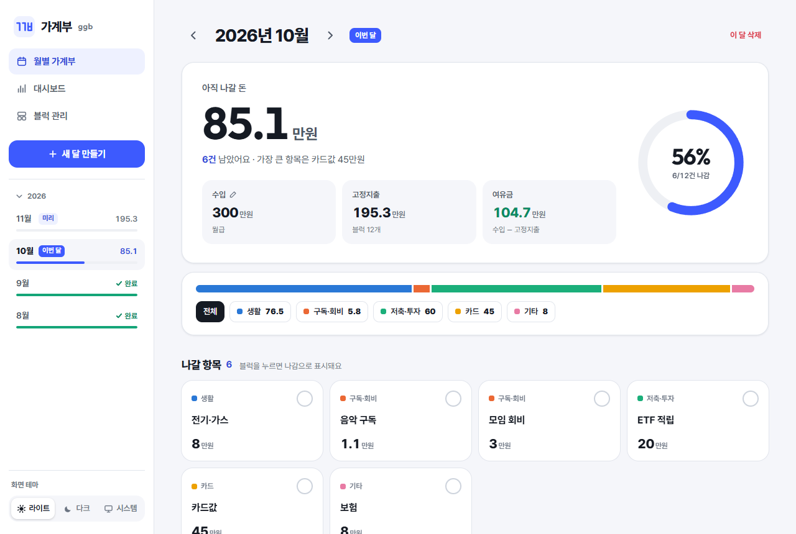
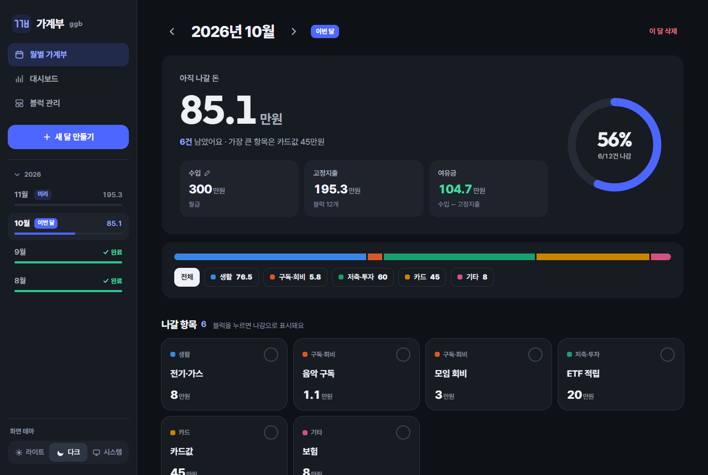
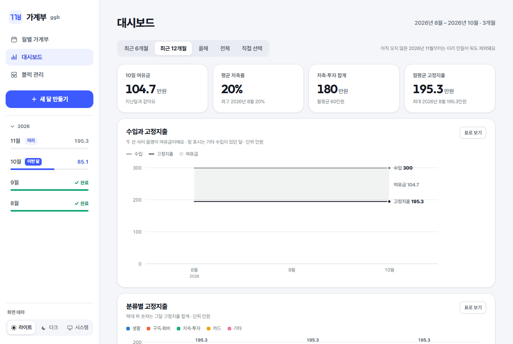

<p align="center">
  <picture>
    <source media="(prefers-color-scheme: dark)" srcset="assets/readme/hero-dark.svg">
    
  </picture>
</p>

<p align="center">
  <a href="../../releases"></a>
  
  
  <a href="LICENSE"></a>
</p>

<p align="center">
  월세, 구독료, 적금처럼 <b>매달 나가는 돈</b>을 블럭으로 만들어 두고,<br>
  나간 블럭을 체크하면 <b>이번 달 아직 나갈 돈</b>이 바로 보이는 로컬 가계부예요.<br>
  내 PC에서만 돌아가고, 데이터도 내 PC의 파일 하나에만 저장돼요.
</p>

<br>

<p align="center">
  
</p>

<br>

## 이런 걸 할 수 있어요

<table>
  <tr>
    <td width="50%" valign="top">
      <h3>아직 나갈 돈</h3>
      이번 달에 남은 돈이 가장 크게 보여요. 블럭을 체크할 때마다 숫자가 부드럽게 줄고, 진행률 링이 차올라요.
    </td>
    <td width="50%" valign="top">
      <h3>블럭으로 쌓는 고정지출</h3>
      한 번 만든 블럭은 블럭 풀에 남아요. 다음 달에는 눌러서 다시 넣기만 하면 돼요.
    </td>
  </tr>
  <tr>
    <td valign="top">
      <h3>새 달은 지난달 그대로</h3>
      새 달을 만들면 지난달 구성과 금액이 미리 채워져요. 바뀐 것만 고치면 돼요.
    </td>
    <td valign="top">
      <h3>대시보드</h3>
      수입과 지출, 분류별 지출, 저축률, 누적 저축, 블럭별 월 금액을 차트로 봐요. 색약을 고려한 색을 써요.
    </td>
  </tr>
  <tr>
    <td valign="top">
      <h3>분류로 거르기, 접기</h3>
      생활, 구독·회비, 저축·투자처럼 분류별로 골라 보고, 이미 나간 항목은 접어 둘 수 있어요.
    </td>
    <td valign="top">
      <h3>라이트, 다크, 시스템</h3>
      다크모드는 색을 뒤집지 않고 따로 설계했어요. 기본값은 Windows 설정을 따라가요.
    </td>
  </tr>
</table>

## 화면

<table>
  <tr>
    <td align="center"><br><sub>월 화면 · 라이트</sub></td>
    <td align="center"><br><sub>월 화면 · 다크</sub></td>
  </tr>
</table>

<p align="center">
  <picture>
    <source media="(prefers-color-scheme: dark)" srcset="assets/readme/dashboard-dark.png">
    
  </picture>
  <br><sub>대시보드 · 지금 GitHub 테마에 맞춰 라이트나 다크로 보여요</sub>
</p>

<p align="center"><sub>스크린샷의 금액과 항목은 모두 예시 데이터예요.</sub></p>

## 시작하기

### 실행 파일로 (Windows)

1. [Releases](../../releases)에서 최신 `ggb-windows.zip`을 받아요.
2. 압축을 풀고 `ggb.exe`를 실행하면 브라우저가 자동으로 열려요.
3. 데이터는 `ggb.exe` 옆의 `data/ggb.db`에 저장돼요.

> [!NOTE]
> 서명되지 않은 실행 파일이라 Windows SmartScreen 경고가 뜰 수 있어요. **추가 정보 → 실행**을 누르세요.

### 소스에서 (Python 3.10 이상)

```bash
git clone https://github.com/sjc4197/gagyebu-ggb.git
cd gagyebu-ggb
pip install -r requirements.txt
python server.py
```

Windows에서는 `run.bat`을 더블클릭해도 돼요. 브라우저가 열리지 않으면 http://127.0.0.1:8765 로 접속하세요.

## 쓰는 법

| 하고 싶은 것 | 방법 |
|---|---|
| 돈이 나간 항목 표시 | 블럭을 눌러요. 다시 누르면 되돌아가요 |
| 금액이나 메모 수정 | 블럭에 마우스를 올리고 `···`를 눌러요 |
| 이전 / 다음 달 | 제목 옆 화살표, 또는 키보드 <kbd>←</kbd> <kbd>→</kbd> |
| 블럭 풀에서 추가 | 아래 블럭 풀의 점선 블럭을 눌러요 |
| 실수로 숨기거나 뺐을 때 | 알림의 **되돌리기**를 5초 안에 눌러요 |
| 테마 바꾸기 | 사이드바 아래 **라이트 / 다크 / 시스템** |

금액 단위는 **만원**이에요. `2.5`는 2만 5천원이에요.

## 설정

| 환경 변수 | 기본값 | 설명 |
|---|---|---|
| `GGB_DB` | `data/ggb.db` | DB 파일 경로 |
| `GGB_PORT` | `8765` | 서버 포트 |

브라우저 자동 열기를 끄려면 `python server.py --no-browser`로 실행하세요.

## 데이터와 보안

- 서버는 `127.0.0.1`에서만 열리고 로그인 기능이 없어요. **외부에 공개되는 서버로 띄우지 마세요.**
- 백업은 `data/ggb.db` 파일 하나만 복사하면 돼요.
- 외부로 보내는 데이터는 없어요. 글꼴(Pretendard, Outfit)만 인터넷에서 받아오고, 오프라인이면 기본 글꼴로 보여요.

## 기술 구성

- **백엔드**: Python, FastAPI, SQLite
- **프론트엔드**: HTML, CSS, JavaScript. 빌드 과정 없이 `static/` 파일을 그대로 써요
- **배포**: GitHub Actions에서 PyInstaller로 Windows 실행 파일을 만들어요

<details>
<summary><b>릴리스 만들기 (관리자용)</b></summary>

<br>

`v`로 시작하는 태그를 푸시하면 GitHub Actions가 Windows 실행 파일을 만들고, 실행해서 응답을 확인한 뒤 Releases에 올려요.

```bash
git tag v0.1.0
git push origin v0.1.0
```

로고를 바꿨다면 아이콘도 다시 만들어요: `pip install pillow && python tools/make_icon.py`

</details>

## 라이선스

[MIT](LICENSE)
